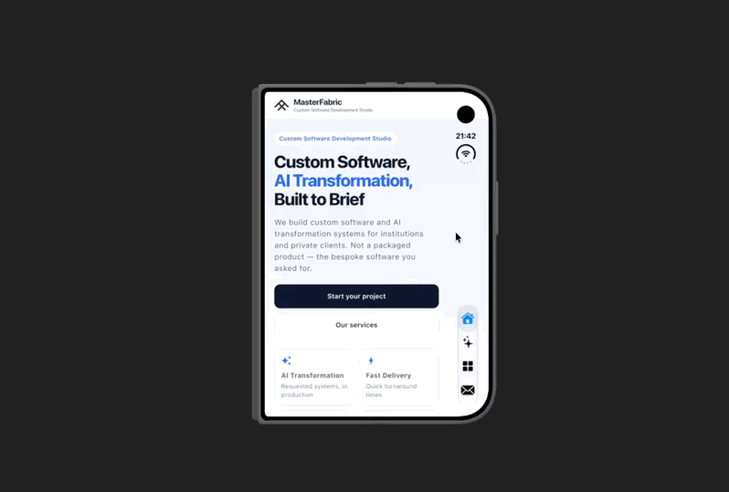
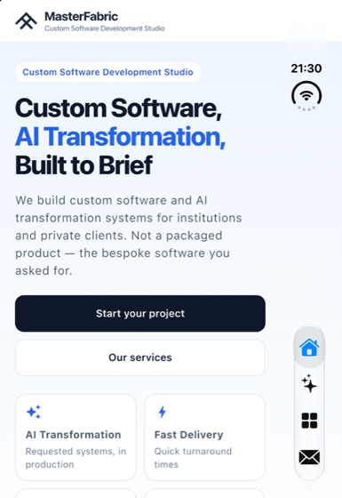
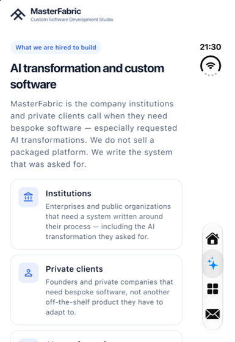
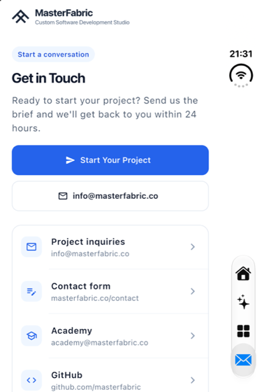

# MasterFabric Flutter Duo

<p align="center">
  
</p>

<p align="center">
  
  
  
  
</p>

<p align="center"><sub>One Flutter codebase that follows the fold: the closed display with the native side tab bar, then unfolded into a split view on the inner display.</sub></p>

**Building Flutter products for iPhone Duo devices.**

This is the mobile version of [masterfabric.co](https://masterfabric.co), built in Flutter and designed for **iPhone Duo**, Apple's foldable iPhone. It follows Apple's [Human Interface Guidelines for iPhone Duo](https://developer.apple.com/design/human-interface-guidelines/designing-for-iphone-duo) and uses the real iOS 27.1 APIs (`UIHingeInteraction`, `UIView.reservedRegions`, `UITraitCollection.verticalBarEdge` and the system vertical tab bar) through a small platform channel.

You can use it as a reference for:

- adapting one Flutter codebase to every iPhone Duo posture: closed, book, flat and tabletop;
- handing navigation to the **native side tab bar** on the closed (outer) display, without giving up the Flutter view;
- structuring a Flutter app with the [masterfabric_core](https://github.com/masterfabric-mobile/masterfabric_core) and [osmea](https://github.com/masterfabric-mobile/osmea) conventions: cubits, base view models and DI.

<p align="center">
  
  
  
  
</p>
<p align="center"><sub>Closed iPhone Duo (outer display, iOS 27.1 simulator): Home, Services, Work and Contact. The system vertical tab bar sits on the <code>verticalBarEdge</code> side, below the clock and the always-visible camera, and the content is inset so the bar never covers it.</sub></p>

---

## Contents

- [Features by posture](#features-by-posture)
- [Apple documentation map](#apple-documentation-map)
- [Architecture](#architecture)
- [State management](#state-management)
- [Platform channel: `masterfabric/duo`](#platform-channel-masterfabricduo)
- [Running on the iPhone Duo simulator](#running-on-the-iphone-duo-simulator)
- [Tests and analysis](#tests-and-analysis)
- [Limitations](#limitations)
- [Roadmap](#roadmap)

---

## Features by posture

The app always shows **one** navigation surface per posture, and the content always stays scrollable and uncovered.

| Posture | How it's detected | Navigation | Content |
| --- | --- | --- | --- |
| **Closed** (outer display) | `UIHingeInteraction` reports `.closed` and the window is single-pane | The **system vertical tab bar** (`UITabBarController` with `UITab`s, SF Symbols) on the `verticalBarEdge` side, in the side safe-area strip | A full-height scrolling page, inset by the side safe area; the wordmark app bar has a Contact shortcut |
| **Book** (partly open, vertical fold) | Hinge `.partiallyOpen` plus a vertical `division` reserved region | The section list on the left pane; you can long-press a section and **drag it across the fold** | The selected section on the right pane; the hinge is never drawn over |
| **Flat** (fully open) | Hinge `.fullyOpen` | The same two-pane layout as book | The same; the state (scroll offset, expanded cards) survives fold and unfold through `GlobalKey`s |
| **Tabletop** (partly open, horizontal fold) | Hinge `.partiallyOpen` plus a horizontal `division` | A **control deck** below the fold with evenly sized section tiles | Content above the fold |
| **Regular iPhone / no bridge** | No hinge, `verticalBarEdge == .unspecified` | A floating Flutter pill bar | Full screen |

The split decision (`DualPaneGeometry.resolve`) uses, in order: Flutter `DisplayFeature`s (once the engine provides them, see [Limitations](#limitations)), then the native `reservedRegions(kind: .division)`, then a width breakpoint. Camera housings (`occlusion` regions) are merged into the safe-area padding, so nothing renders under them.

If the native bar can't be shown but the system reports a vertical bar edge, a Flutter `DuoNavRail` is used as the fallback, on that edge. It's never shown at the same time as another navigation surface.

## Apple documentation map

| Feature in this app | Apple guidance / API |
| --- | --- |
| Side tab bar on the closed display; no override of bar placement | HIG: [Designing for iPhone Duo, Vertical controls](https://developer.apple.com/design/human-interface-guidelines/designing-for-iphone-duo#Vertical-controls): *"the system places toolbars and tab bars on the side to maximize the vertical space for content"*, *"In general, don't override the default bar placement"* |
| A title **and** a symbol for each tab | HIG: *"Provide both a title and a symbol for each toolbar item"*; [`UITab`](https://developer.apple.com/documentation/uikit/uitab), [`UITabBarController`](https://developer.apple.com/documentation/uikit/uitabbarcontroller) |
| Content inset by the vertical bar's safe area | HIG: *"Use safe areas to make sure controls don't cover your content"*; [`safeAreaInsets`](https://developer.apple.com/documentation/uikit/uiview/safeareainsets) |
| Bar placed on the system's edge | [`UITraitCollection.verticalBarEdge`](https://developer.apple.com/documentation/uikit/uitraitcollection/verticalbaredge), [`UIVerticalBarCompressionBehavior`](https://developer.apple.com/documentation/uikit/uiverticalbarcompressionbehavior) |
| Tabs start below the always-visible outer camera | HIG: *"The outer front-facing camera is in the corner and is always visible, vertically aligned with controls on the side"*; [`reservedRegions(kind:options:)`](https://developer.apple.com/documentation/uikit/uiview/reservedregions(kind:options:)) with `.occlusion` |
| Hinge status and angle drive the posture | [`UIHingeInteraction`](https://developer.apple.com/documentation/uikit/uihingeinteraction), [`UIHinge`](https://developer.apple.com/documentation/uikit/uihinge) |
| Two panes split exactly at the fold | HIG: [Split views](https://developer.apple.com/design/human-interface-guidelines/designing-for-iphone-duo#Split-views); [`UIView.ReservedRegion`](https://developer.apple.com/documentation/uikit/uiview/reservedregion) with `.division`; [`UIArrangementViewController`](https://developer.apple.com/documentation/uikit/uiarrangementviewcontroller) |
| Layout adapts across postures with continuity | HIG: [Dynamic layouts](https://developer.apple.com/design/human-interface-guidelines/designing-for-iphone-duo#Dynamic-layouts); [Preparing your app for iPhone Duo](https://developer.apple.com/documentation/technologyoverviews/preparing-your-app-for-iphone-duo) |
| Testing every posture | [Device Hub](https://developer.apple.com/documentation/xcode/device-hub) |

Tech talks:

- [Design for iPhone Duo](https://developer.apple.com/videos/play/tech-talks/111466)
- [Raise the bar with iPhone Duo](https://developer.apple.com/videos/play/tech-talks/111462)
- [Strike a pose with adaptive layouts on iPhone Duo](https://developer.apple.com/videos/play/tech-talks/111463)

## Architecture

The project mirrors two MasterFabric references:

- [**masterfabric_core**](https://github.com/masterfabric-mobile/masterfabric_core): the `BaseViewModelCubit` with `stateChanger`, Equatable states, a `get_it` service locator, and helpers under `helper/`.
- [**osmea**](https://github.com/masterfabric-mobile/osmea): `lib/app/{core/bloc, views/view_<name>/{<name>_view.dart, models, widgets}, widgets}` and package imports.

```text
lib/
├── main.dart                         # bootstrap: DI, DuoBridge.start(), runApp
└── app/
    ├── app.dart                      # MasterFabricApp: MultiBlocProvider + MaterialApp
    ├── core/
    │   ├── base/base_view_model_cubit.dart
    │   ├── bloc/
    │   │   ├── duo/{duo_cubit,duo_state}.dart              # posture + native tab bar
    │   │   └── navigation/{navigation_cubit,navigation_state}.dart
    │   └── di/injection.dart         # get_it registrations
    ├── helper/layout/duo/
    │   ├── duo_bridge.dart           # masterfabric/duo MethodChannel client
    │   ├── fold_info.dart            # FoldInfo, HingeStatus, ReservedRegion, VerticalBarEdge
    │   ├── dual_pane_layout.dart     # DualPaneGeometry, DualPane, occlusion insets
    │   └── duo_nav_rail.dart         # Flutter fallback rail + HingeGlyph
    ├── models/site_content.dart      # masterfabric.co copy
    ├── theme/app_theme.dart          # MfColors + AppTheme
    ├── views/
    │   ├── view_shell/               # ShellView: picks the nav per posture
    │   │   ├── shell_view.dart
    │   │   ├── models/shell_section.dart
    │   │   └── widgets/section_list_widget.dart
    │   ├── view_home/home_view.dart
    │   ├── view_services/services_view.dart
    │   ├── view_work/work_view.dart
    │   └── view_contact/contact_view.dart
    └── widgets/                      # common, links, mf_logo, pill_nav_bar
ios/Runner/AppDelegate.swift          # DuoBridgePlugin, NativeSideTabs, SideTabBarController
test/                                 # widget, Duo layout and cubit tests
```

## State management

App state lives in two cubits (`flutter_bloc`). Both extend `BaseViewModelCubit` and are registered in `get_it`.

| Cubit | State | Source of truth |
| --- | --- | --- |
| `NavigationCubit` | `NavigationState(index)` | Taps from the pill bar, section list, tabletop deck, CTAs, drag-and-drop, **and the native side tab bar** (`tabSelected`) |
| `DuoCubit` | `DuoState(info: FoldInfo, nativeTabsShown)` | `DuoBridge` (`update` pushes, `getState` on metrics changes, and the `setTabs` result) |

```text
UIHingeInteraction / reservedRegions / verticalBarEdge
        │  "update" (native → Dart)
        ▼
   DuoBridge ──notifies──▶ DuoCubit ──▶ BlocBuilder<DuoCubit> in ShellView
        ▲                                     │ picks the layout for the posture
        │ "setTabs" (Dart → native)           │
        └──────── DuoCubit.syncNativeTabs ◀───┘ (closed + single pane ⇒ visible)

Native tab tap ─ "tabSelected" ─▶ DuoBridge.onNativeTabSelected ─▶ NavigationCubit.select
Flutter nav taps ───────────────────────────────────────────────▶ NavigationCubit.select
NavigationCubit ─▶ ShellView rebuilds ─▶ setTabs(selected) keeps the native bar in sync
```

`ShellView` keeps only UI resources (page `GlobalKey`s for state continuity across fold and unfold); there is no `setState`-driven app state.

## Platform channel: `masterfabric/duo`

A single `MethodChannel('masterfabric/duo')`, implemented by `DuoBridgePlugin` in `ios/Runner/AppDelegate.swift` and consumed by `DuoBridge` in `lib/app/helper/layout/duo/duo_bridge.dart`.

| Method | Direction | Arguments | Returns |
| --- | --- | --- | --- |
| `getState` | Dart → iOS | none | State map (below); installs the hinge interaction on first call |
| `update` | iOS → Dart | State map | none; pushed on every hinge change and again 0.35 s later, when the reserved regions have settled |
| `setTabs` | Dart → iOS | `{tabs: [{title, symbol}], selected: int, visible: bool}` | `bool`: whether the native side tab bar is showing |
| `tabSelected` | iOS → Dart | `int` tab index | none |

State map:

```json
{
  "supported": true,
  "hinge": "closed | partiallyOpen | fullyOpen | none | unknown",
  "angle": 180.0,
  "divisions":  [{ "x": 0, "y": 0, "width": 0, "height": 0, "active": true }],
  "occlusions": [{ "x": 0, "y": 0, "width": 0, "height": 0, "active": true }],
  "viewWidth": 402.0,
  "viewHeight": 874.0,
  "verticalBarEdge": "leading | trailing | unspecified"
}
```

### iOS side (Swift)

Hinge status and angle come from `UIHingeInteraction` (iOS 27.1+):

```swift
if #available(iOS 27.1, *) {
  let interaction = UIHingeInteraction { [weak self] _, update in
    guard let self else { return }
    if let hinge = update.hinge {
      switch hinge.status {
      case .closed: self.hingeStatus = "closed"
      case .partiallyOpen: self.hingeStatus = "partiallyOpen"
      case .fullyOpen: self.hingeStatus = "fullyOpen"
      default: self.hingeStatus = "unknown"
      }
      self.hingeAngleDegrees = Double(hinge.angle) * 180.0 / Double.pi
    }
    self.pushUpdate()  // channel.invokeMethod("update", arguments: currentState())
  }
  view.addInteraction(interaction)
}
```

Reserved regions and the vertical bar edge:

```swift
if #available(iOS 27.1, *) {
  state["divisions"]  = encode(view.reservedRegions(kind: .division, options: .includeInactive))
  state["occlusions"] = encode(view.reservedRegions(kind: .occlusion))
  switch view.traitCollection.verticalBarEdge {
  case .leading:  state["verticalBarEdge"] = "leading"
  case .trailing: state["verticalBarEdge"] = "trailing"
  default:        state["verticalBarEdge"] = "unspecified"
  }
}
```

**The native side tab bar** (`NativeSideTabs` and `SideTabBarController`):

- A `UITabBarController` is added as a **child** of the `FlutterViewController`. Its view frame is the side safe-area strip that UIKit reserves for the vertical bar, so UIKit lays its tab bar out vertically there.
- The tab content controllers are transparent and non-interactive, so the Flutter view stays in charge of the content.
- The `FlutterViewController` **stays the window root**. Swapping the root for a `UITabBarController` detaches the Flutter view and blanks the screen.
- If UIKit doesn't lay the bar out vertically, a native `VerticalTabBar` (SF Symbol above a title, 56 pt minimum) is used, placed below the camera occlusion.

```swift
let controller = SideTabBarController { [weak self] i in self?.onSelect(i) }  // → "tabSelected"
owner.addChild(controller)            // owner = FlutterViewController (still the root)
host.addSubview(controller.view)      // host  = Flutter view
controller.didMove(toParent: owner)
controller.view.frame = sideStrip     // e.g. the 84 pt trailing safe-area strip
controller.setTabs(specs.enumerated().map { i, spec in
  UITab(title: spec.0, image: UIImage(systemName: spec.1), identifier: "mf.tab.\(i)") { _ in
    let vc = UIViewController(); vc.view.backgroundColor = .clear
    vc.view.isUserInteractionEnabled = false; return vc
  }
}, animated: false)
```

### Dart side

```dart
// lib/app/helper/layout/duo/duo_bridge.dart
_channel.setMethodCallHandler((call) async {
  switch (call.method) {
    case 'update':
      _apply(call.arguments);                      // → FoldInfo.fromMap → notifyListeners
    case 'tabSelected':
      final i = call.arguments;
      if (i is int) onNativeTabSelected?.call(i);  // → NavigationCubit.select
  }
});

// ShellView: hand navigation to the native bar while the Duo is closed.
context.read<DuoCubit>().syncNativeTabs(
  tabs: [for (final s in kShellSections) (title: s.item.label, symbol: s.symbol)],
  selected: navigationIndex,
  visible: !geometry.isDual && fold.hinge == HingeStatus.closed,
);
```

`syncNativeTabs` de-duplicates identical calls, and Flutter keeps its own navigation until iOS confirms (`true`) that the native bar is showing. That way the app is never left without a navigation surface.

## Running on the iPhone Duo simulator

Requirements: Xcode with the iOS 27.1 SDK and the **iPhone Duo** simulator runtime, and Flutter stable (tested on 3.47.8).

```bash
flutter pub get
xcrun simctl list devices | grep "iPhone Duo"    # find the simulator id
xcrun simctl boot <DUO_SIM_ID>
flutter run -d <DUO_SIM_ID>
```

- Change the posture (closed, book, flat, tabletop) from Xcode's [Device Hub](https://developer.apple.com/documentation/xcode/device-hub).
- Open a section at launch with `flutter run -d <id> --dart-define=MF_TAB=2` (0 Home, 1 Services, 2 Work, 3 Contact).
- Capture the outer display with `xcrun simctl io <id> screenshot --display=1 out.png`.

## Tests and analysis

```bash
flutter analyze   # strict: strict-casts/inference/raw-types, public_member_api_docs, package imports…
flutter test      # widget + Duo layout + cubit tests
```

- `test/widget_test.dart`: one nav per posture, the native tab bar hand-off, drag across the fold, tabletop.
- `test/duo_layout_test.dart`: geometry from display features, reserved regions and breakpoints; occlusion insets; the rail fallback.
- `test/cubit_test.dart`: `NavigationCubit` (clamping, selection, native taps, detaching on close) and `DuoCubit` (mirroring the bridge, closing).

## Limitations

- **Flutter doesn't report iPhone Duo display features yet.** On iOS, `MediaQuery.displayFeatures` is empty, which is why this app reads the hinge and reserved regions through its own channel. Upstream tracking:
  - [flutter/flutter#192515](https://github.com/flutter/flutter/issues/192515): *Proposal: populate MediaQuery.displayFeatures on iOS for iPhone Duo*.
  - [flutter/flutter#193025](https://github.com/flutter/flutter/pull/193025): *Populate display features from the iPhone Duo hinge and reserved regions*.

  Once that lands, `DualPaneGeometry` already prefers `DisplayFeature`s, and the channel remains for the native tab bar.
- The side tab bar is UIKit, layered over the Flutter view. Its look follows the system, not the Flutter theme.
- The posture screenshots above are from the simulator's outer display. The inner, open-display captures still need Device Hub to open the simulator.
- iOS only. Other platforms fall back to breakpoints and the pill bar.

## Roadmap

- [ ] Drop the custom geometry path when flutter/flutter#193025 ships, and keep the channel for the bars only.
- [ ] Inner-display (book, flat and tabletop) screenshots and golden tests.
- [ ] A native vertical **toolbar** (`UIBarButtonItemVisibilityPriority`, overflow) for section actions.
- [ ] Extract `masterfabric/duo` into a reusable Flutter plugin package (`masterfabric_duo`).
- [ ] Localization (slang) and hydrated state, as in masterfabric_core.
- [ ] Routing with go_router once the app has deep-linkable detail pages.

---

© 2026 MasterFabric. Built by [MasterFabric](https://masterfabric.co).
